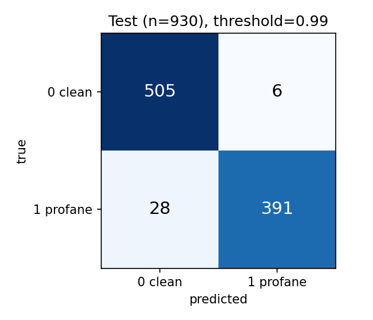
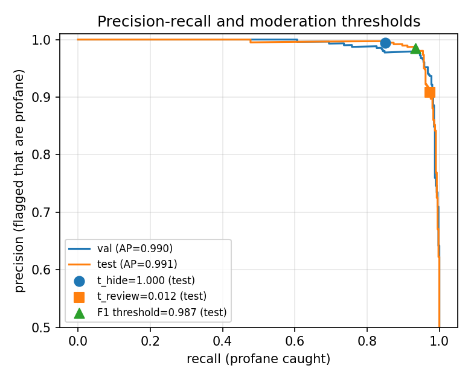

# Kazakh Profanity Detection

**Task.** Input: one Kazakh (or mixed Kazakh–Russian) review / comment about goods, apps or
places. Output: `1` = contains Kazakh profanity, `0` = no profanity, plus the probability,
a moderation decision and the words that triggered it.

```
$ python predict.py "Қотақбас ойын екен, тартпаңдар" "Тауар сапасы нашар, бірақ жеткізу тез болды"
1 = PROFANITY     p=1.000  [auto-hide]  | Қотақбас ойын екен, тартпаңдар
                   triggered by: «Қотақбас» (+0.99)
0 = no profanity  p=0.000  [publish]  | Тауар сапасы нашар, бірақ жеткізу тез болды
                   no single decisive word
```

**Final model:** Kaz-RoBERTa (6-layer Kazakh RoBERTa, 83M parameters) fine-tuned on 9,181 reviews.
**Test (930 reviews, 419 profane): precision 0.985 · recall 0.933 · F1 0.958.**
On 1,500 ordinary Kaspi product reviews it produced **0 false positives**.

**What is different in this project** (short version for the defense):

1. **Data audit.** The course dataset had 42 wrong labels, 28 duplicates and 18
   near-duplicate groups leaking across train/val/test — found, fixed, documented.
2. **3× more data** from the same source corpus (KazSAnDRA): 9,360 real rows,
   written labeling rules, hard negatives ("көтеру", "сигнал", "мал шаруашылығы", Among Us).
3. **Tested on ordinary reviews**: a separate set of 2,999 normal reviews (50% Kaspi product
   reviews) measures how many honest customers a moderator would wrongly hide.
4. **Five architectures compared** (Kazakh RoBERTa, mDeBERTa-v3, XLM-R, char-CNN from scratch,
   TF-IDF) on quality, robustness, size and speed — chosen on validation only.
5. **Moderation policy, not just F1**: two thresholds → auto-hide / human review / publish.
6. **Explanations**: leave-one-word-out shows which word triggered each prediction.
7. **Stress test**: masking (с*ка), Latin (qotaq), no Kazakh keyboard (котак), stretched
   letters, s p a c e d letters, digits (қ0т@қ).

---

## 1. Data

Full card: **[docs/DATASET.md](docs/DATASET.md)** · rules: **[docs/labeling_guidelines.md](docs/labeling_guidelines.md)**

* **Source**: the course file `kazakh_profanity_share.csv` (3,061 rows) and the full
  **KazSAnDRA** corpus it was sampled from (ISSAI, 175k Kazakh reviews of apps,
  marketplace products, places and books; public download: `scripts/00_download_data.py`).
* **Labeling**: 1 = Kazakh obscene words, Russian mat inside Kazakh/mixed text, or vulgar
  insults aimed at someone (мал, есек, ақымақ, тупой, чорт …) — the convention the course data
  already followed. Negative ≠ profane; literal senses, meta-mentions and negation are 0;
  masked words (с*ка, қо*ақ) and any spelling/script count. Undecidable rows were excluded.
* **Audit**: lexicon conflicts + out-of-fold model disagreements → 200 rows read → 42 labels
  fixed (`data/label_corrections.csv`, each with a reason).
* **New rows**: lexicon + reference-model agreement → automatic label; all 1,092
  disagreements reviewed against the guidelines (AI-assisted, see Acknowledgement).
* **Duplicates / splits**: exact duplicates removed; near-duplicates (char TF-IDF cosine ≥ 0.8)
  grouped and kept in one split; course rows keep their course split, new rows 80/10/10,
  `SEED = 42`. Synthetic obfuscated rows (`is_synthetic = 1`) are train-only.
* **Privacy**: phones, e-mails, URLs, @handles, surnames → placeholders.

| split | rows | profane | used for |
|---|---|---|---|
| train | 7,504 (+1,677 synthetic) | 3,001 | training |
| val | 926 | 409 | model / architecture selection, thresholds |
| test | 930 | 419 | final evaluation |
| clean_eval | 2,999 | 3 | false-positive test on ordinary reviews |

Examples:

| text | label | why |
|---|---|---|
| Қотақбас екен | 1 | Kazakh obscene word (was 0 in the course data) |
| Пашол наху жазылмады бла 0☆ | 1 | Russian mat in a Kazakh comment |
| Б** з@еб@**л мына ойын | 1 | masked mat |
| Мал ойын тартпаңдар | 1 | "мал" (cattle) as an insult |
| Жамаан ойын | 0 | negative, not profane |
| Ақтөбе облысы бойынша төрт түлік мал | 0 | literal livestock |
| Маған осы амок ас үнайды | 0 | "Among Us" (was 1 in the course data) |

## 2. Model

### Architecture comparison (`scripts/11_compare_architectures.py`)

All models: same data (train + synthetic), same preprocessing, cross-entropy, threshold chosen
on val. Transformers: AdamW lr 2e-5, effective batch 32, 4 epochs, 10% warm-up, mixed precision.
**Selection criterion (fixed in advance, validation only): mean of val F1 and val-obfuscated F1.**

| model | type | params | train time | val F1 | val-obf F1 | **selection** | test F1¹ | clean_eval FP¹ | CPU ms / comment |
|---|---|---|---|---|---|---|---|---|---|
| **Kaz-RoBERTa** (`kz-transformers/kaz-roberta-conversational`) | Kazakh transformer, 6 layers | 83M | 1.7 min | **0.962** | 0.921 | **0.941** | 0.958 | **0.9%** | 15.6 |
| mDeBERTa-v3-base | multilingual transformer, 12 layers | 279M | 9.5 min | 0.951 | 0.926 | 0.939 | **0.964** | 1.4% | 86.1 |
| char TF-IDF + logistic regression | linear | 57k | 1 s | 0.937 | **0.934** | 0.936 | 0.936 | 1.3% | 0.5 |
| char-CNN, trained from scratch (`src/charcnn.py`) | CNN over characters | 0.19M | 34 s | 0.955 | 0.904 | 0.929 | 0.948 | 1.9% | 0.9 |
| XLM-RoBERTa-base | multilingual transformer, 12 layers | 278M | ~13 min² | 0.935 | 0.904 | 0.919 | 0.940 | 1.9% | 34.2 |
| XLM-RoBERTa-base, no synthetic data | | 278M | ~13 min² | 0.940 | 0.864 | 0.902 | 0.940 | 2.9% | 33.6 |
| *lexicon rules (`src/lexicon.py`)* | *regex, not trained* | — | — | *0.956³* | *0.942³* | — | *0.941³* | — | 0.1 |

¹ reported for information; the choice uses val only. ² on a shared GPU, not comparable.
³ not eligible: the lexicon was written while reading the whole course file (val/test included)
for the label audit, so its scores are optimistic; and the task requires a trained model.

**Why Kaz-RoBERTa wins.** It was pre-trained (masked-LM) on 25 GB of *Kazakh* text: the
multi-domain MDBKD corpus plus Beeline-KZ customer-support dialogues — informal user language,
i.e. the same register as reviews. Its byte-level BPE vocabulary (52k) is Kazakh-specific:
"сука" and "нахуй" are single tokens, "қотақбас" splits into 4 Kazakh pieces, whereas the
multilingual models spend their 250k vocabulary on 100 languages. Result: the best val score
with **3× fewer parameters** than XLM-R, **2-minute** training and 15 ms per comment on a CPU.

**What the comparison teaches.**
* The task is **very lexical**: a char-level TF-IDF or a 0.19M-parameter CNN is within 1–3 F1 of
  the transformers on ordinary text. Pre-training pays off mainly in **precision on ordinary
  reviews** (0.9% vs 1.3–1.9% false positives) and in context (literal "мал шаруашылығы" vs
  insult "мал ойын").
* **Language-specific pre-training beats size**: 6-layer Kazakh RoBERTa > 12-layer XLM-R.
* **Synthetic spelling variants matter**: XLM-R without them loses 4 F1 on disguised text.

### Final model: Kaz-RoBERTa

RoBERTa encoder: 6 layers, hidden size 768, 12 attention heads, feed-forward 3072,
byte-level BPE vocabulary of 52,000, max 512 positions. A classification head (dense + tanh +
linear, 2 outputs) on the `<s>` token is trained together with the whole encoder.

**Text → input** (`src/preprocess.py`): anonymise, lower-case, collapse 3+ repeated characters
to 2 ("бляяяя" → "бляя", "😡😡😡😡" → "😡😡"), normalise spaces. Punctuation, emoji and `*`
masks are kept (they carry signal). Byte-level BPE has **no unknown tokens**: any character
sequence (Cyrillic, Latin, emoji, `*`) is split into known sub-words or bytes. Nothing is
learned in preprocessing; the tokenizer is the pre-trained one (the char-CNN's character
vocabulary, by contrast, is built on train only).

**Long comments**: 98% of texts are ≤ 128 tokens (median 17). Training truncates to 128.
At inference long texts are cut into overlapping 128-token windows (stride 63) and the comment
gets the **maximum** window probability, so a swear word at the end is not lost.

**Training** (`scripts/05_train.py`): cross-entropy, AdamW (lr 2e-5, weight decay 0.01), linear
warm-up 10% + decay, batch 32, 4 epochs, fp16 mixed precision with fp32 master weights,
grad-clip 1.0, `seed 42`. The epoch with the best val F1 is kept (epoch 4: val F1 0.958 at 0.5);
the decision threshold maximises val F1 → **0.987**. The threshold is that high because the
fine-tuned model is very confident (final train loss 0.026); the probabilities are not calibrated.
All runs are logged to Weights & Biases (metrics only) and in `logs/`, `models/*/history.json`.

## 3. Results (test)

| set | n | precision | recall | **F1** | false-positive rate |
|---|---|---|---|---|---|
| **test** | 930 (419 profane) | 0.985 | 0.933 | **0.958** | 0.012 |
| test, course rows only | 286 (174) | 0.988 | 0.931 | 0.959 | 0.018 |
| test, mined rows | 286 (244) | 0.987 | 0.934 | 0.960 | 0.071 |
| test, obfuscated copy | 930 (419) | 0.951 | 0.885 | 0.917 | 0.037 |
| **clean_eval** — all ordinary reviews | 2,999 (3) | — | — | — | **0.009** (27 of 2,996) |
| clean_eval — Kaspi product reviews | 1,500 | — | — | — | **0.000** |



Confusion matrix (test): **TN 505 · FP 6 · FN 28 · TP 391**. PR-AUC 0.991.
Negative 1–2★ reviews in test: 0 of 93 flagged; random clean reviews: 0 of 191; look-alike words
(көтеру, сигнал, Among Us …): 1 of 73 — *a negative review is not mistaken for profanity*.

### What the errors mean

* **False positive** = an honest review is hidden. The customer is angry, the shop loses
  feedback, moderators get complaints. For a product-review site this is the costlier error
  *when the action is automatic*.
* **False negative** = profanity is published. Brand / platform harm, but one rude review among
  thousands is seen by few people and can be reported.

The model at its F1 threshold is precision-oriented (6 FP vs 28 FN). Many "FN" have p = 0.82–0.98,
just under the strict threshold — which is why a single threshold is not how it should be deployed:

### Moderation policy (`scripts/07_moderation.py`)

Thresholds chosen on **val**: `t_hide = 0.9996` (val precision ≥ 0.98) and `t_review = 0.0118`
(val recall ≥ 0.98). Saved in `models/kazroberta/moderation.json`, used by `predict.py`.

| on test | auto-hidden | to a human | published |
|---|---|---|---|
| profane comments (419) | **85.0%** | 12.4% | 2.6% (missed) |
| clean comments (511) | 0.4% (wrongly) | 7.6% | **92.0%** |

On the realistic stream of ordinary reviews (clean_eval, 2,999): **96.4%** published automatically,
3.4% go to a moderator, 0.17% hidden automatically (0.13% of the clean ones), and all 3 real profane
reviews were caught (1 hidden, 2 to a moderator). Compared with the single threshold (0.9% of honest
reviews hidden), the policy hides ~7× fewer honest reviews and misses fewer profane ones, at the cost
of a human queue of ~3–4% of normal traffic.



### Stress test (`scripts/08_stress_test.py`)

Each test row rewritten with one disguise (`results/stress_test.csv`); F1 on test:

| attack (example) | lexicon | TF-IDF | char-CNN | XLM-R | mDeBERTa | **Kaz-RoBERTa** |
|---|---|---|---|---|---|---|
| original | 0.941 | 0.943 | 0.948 | 0.940 | **0.964** | 0.958 |
| CAPS (ҚОТАҚБАС) | 0.941 | 0.943 | 0.948 | 0.940 | **0.965** | 0.958 |
| no Kazakh keyboard (котакбас) | 0.941 | 0.943 | 0.939 | 0.933 | **0.947** | 0.941 |
| stretched (қотааақбас) | 0.941 | **0.943** | 0.939 | 0.931 | **0.943** | 0.925 |
| Latin (qotaqbas) | 0.925 | **0.942** | 0.851 | 0.853 | 0.882 | 0.836 |
| leet (қ0т@қб@с) | 0.669 | 0.718 | **0.891** | 0.811 | 0.859 | 0.694 |
| s p a c e d letters | 0.004 | 0.733 | 0.698 | 0.561 | **0.766** | 0.573 |
| masked (қ******с) | 0.617 | **0.748** | 0.711 | 0.628 | 0.625 | 0.674 |

* The **lexicon collapses** on spacing (0.004) and leet. TF-IDF is strong on Latin because the
  same Latin → Cyrillic normalisation is applied before it.
* **Kaz-RoBERTa is the best on ordinary text but not the most robust**: its Kazakh vocabulary has
  few Latin and digit pieces, so leet (0.69) and Latin (0.84) hurt it more than the multilingual
  mDeBERTa or the char-CNN (which sees every character). A deployment that expects many disguised
  comments should prefer mDeBERTa or add a normalisation step (below).
* **Masking**: all neural models learned "a word with `*` inside = profanity" (recall 0.99–1.0, but
  65–98% of *clean* reviews are flagged if a random word is starred; TF-IDF 29%). In real reviews
  people star only bad words, so the cue is mostly right — but it is a shortcut.
* Practical improvement: Latin → Cyrillic transliteration and "join single letters separated by
  spaces" before the model, plus spaced / leet / clean-masked rows in the synthetic data.

### Error analysis

Files: `results/test_predictions.csv`, `results/test_errors.csv` (28 FN, 6 FP, sorted by confidence),
`results/clean_eval_false_positives.csv`. Trigger words below come from `predict.py` (leave-one-word-out).

1. **Spurious slang cue — FP.** "М,да тариф бағасы өсіпті. ЧЁ та басқаға ауысамын-ау…" (a calm
   complaint about tariffs) → p = 0.999, triggered by **«ЧЁ» (+1.00)**. Russian slang "чё" ("what")
   co-occurs with mat in training ("Чё за ….."), so the model learned it as a profanity cue.
   With the moderation policy it goes to a human, not auto-hidden.
2. **Memorised context — FP (and a debatable label).** "Иә бэха көп мерс аз. Мерс ұшады бмв тышады"
   → p = 0.988, triggered by **car brands** («Мерс» +0.32, «бэха» +0.15, «бмв» +0.13), not by "тышады".
   A training row "Мерс сила БМВ магила … БМВ тышат" is labeled 1. By our own rule
   ("тышу" used to run down a product = 1) the test label 0 is arguably wrong — the model may be
   right for the wrong reason.
3. **Look-alike sub-words — FP.** "Ай малдес топқой тик ток" (*малдес* = молодец, "well done") → p ≈ 1.0;
   on clean_eval "Тока бокадан асқан ойын жоқ" (the game Toca Boca) → «бокадан» +0.83 (contains *бок*,
   "shit"). *Fix*: hard negatives with малдес / малатца / Тока Бока.
4. **Rare spelling — FN.** "Хуйнйа паста басқа жака береді" (хуйня spelled with "йа") → p = 0.09.
   The misspelling splits into unfamiliar byte pieces. It still lands above `t_review`, so a moderator sees it.
5. **One swear word inside a long complaint — FN.** "…латын арипимен 10 симбл жаздым, нихуя киргизбит" → p = 0.0003.
   The same phrase alone, "нихуя киргизбит", gets p = 1.000; with "Оте нашар екен," in front p = 0.22;
   inside the full complaint p ≈ 0. The single word is diluted by neutral context — the model has
   seen *нихуя* mostly in short angry comments. *Fix*: more long negative reviews containing one swear word.
6. **Doubled characters — FN.** "Маған ббббббллллааааттттт ссссууууууккккаааа ұнады" → p = 0.006.
   Preprocessing reduces runs to two letters ("ббллаатт"), which still does not look like "блат сука".
   *Fix*: also score a "runs → 1 letter" view of the text.
7. **The silver clean set has errors too.** A clean_eval "false positive" is "поху маған кушті ойын" —
   *поху(й)* is mat, so the model is right and the label is wrong; clean_eval FP rates are slightly pessimistic.

**Which errors matter for moderation.** FN like 4–6 are rare, low-visibility and mostly caught by the
human-review band. FP like 1–3 hit honest customers; on product reviews (Kaspi) there were none,
the remaining ones are app reviews with youth slang. Automatic hiding therefore uses the strict
threshold and everything uncertain goes to a human.

## 4. How to run

```bash
pip install -r requirements.txt          # Python 3.13; torch CUDA build for training
```

Use the trained model (no retraining):

```bash
python scripts/10_download_model.py --repo <hf-username>/kazakh-profanity-kazroberta
python predict.py "Мына ойын керемет екен"      # or: python predict.py  (interactive)
```

Reproduce everything:

```bash
python scripts/00_download_data.py       # KazSAnDRA -> data/raw
python scripts/01_audit_labels.py        # flags suspicious course labels
python scripts/02_mine_kazsandra.py      # candidates + review queue
python scripts/03_build_dataset.py       # final dataset + splits -> data/processed
python scripts/04_check_dataset.py       # TF-IDF sanity check of the data
# final model (~2 min on an 8 GB GPU); add --wandb to log to Weights & Biases
python scripts/05_train.py --model-name kz-transformers/kaz-roberta-conversational --run-name kazroberta
# architectures compared
python scripts/05_train.py --run-name xlmr_base                               # XLM-R-base
python scripts/05_train.py --run-name xlmr_nosynth --no-synthetic
python scripts/05_train.py --model-name microsoft/mdeberta-v3-base --run-name mdeberta --precision bf16 --grad-accum 2
python scripts/05b_train_charcnn.py                                          # char-CNN from scratch
python scripts/11_compare_architectures.py   # selection on val + speed / size table
python scripts/06_evaluate.py --split test   # final model on test + clean_eval -> results/
python scripts/07_moderation.py              # two-threshold policy + PR curve
python scripts/08_stress_test.py             # obfuscation stress test, all models
```

Manual decisions (`data/label_corrections.csv`, `data/interim/review_decisions_part*.csv`,
`data/manual_labels_clean_eval.csv`) are in the repository, so steps 2–3 reproduce the same
files byte-for-byte.

## 5. Limitations

* Profanity vs "rude but acceptable" (тупой, ақымақ, мал) is a convention; another moderator could
  draw the line elsewhere.
* Labels of mined rows were produced by lexicon + model agreement or by AI-assisted review against
  written rules — not by multiple human annotators.
* Most data are Google Play app reviews; marketplace product reviews are a minority.
* clean_eval labels are "silver" (lexicon-free + low reference-model score).
* The final model is less robust to Latin / digit disguises than mDeBERTa or the char-CNN
  (see the stress test); its probabilities are over-confident (threshold 0.987).
* The model sees only text: sarcasm, thread context or images are out of scope.

## Repository layout

```
predict.py                     custom text -> label, probability, decision, trigger words
src/                           preprocess, inference (sliding windows), explain, char-CNN, lexicon, augment
scripts/00..11                 data pipeline, training, evaluation, moderation, stress test, comparison, upload
data/processed/                final dataset (see docs/DATASET.md)
results/                       metrics, confusion matrix, PR curve, predictions, errors, comparisons
results/xlmr_base/             the same evaluation for the XLM-R run
logs/                          training logs
docs/                          dataset card and labeling guidelines
```

## Acknowledgement of assistance

Code, data audit, lexicon and the review of ambiguous mined rows were done with the help of an
AI assistant (Claude). Every changed or reviewed label is stored with a written reason; the
labeling rules, model choice and analysis were checked and are explained by me.
